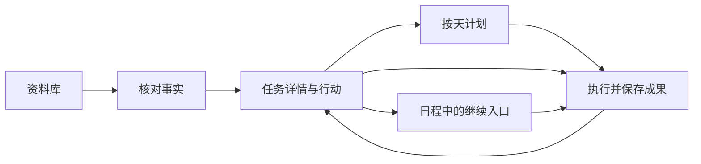

# MVP阶段3至6实施方案

日期：2026-11-20。状态：设计方案，尚未实施。目标：补齐原MVP的行动、专注、备份、规划和公开交付，形成可持续使用的闭环。

范围以《2026-11-18-Qoder下一阶段MVP执行计划》为准；本文明确剩余阶段的页面、业务规则、执行批次和验收出口。《2026-11-20-行动执行闭环产品设计》作为任务与执行页面的细节参考。本文不代表阶段3–6已完成，也不授权Qoder一次连续实现全部阶段。

## 1 成功标准

用户从一张课程通知建立任务，为任务选择下一步，将工作安排到某天，执行并保留成果；次日继续时无需重新找资料或回忆进度。导出后能在新工作区恢复，陌生用户能从公开演示入口自行体验。

保留日程、资料库、待核对三个主导航。新增任务详情、执行、规划与备份作为次级工作面，不继续增加同层任务列表。提醒限网页内，不承诺关闭网页后的系统通知。保持北京时间、本地优先和人工确认规则。



## 2 页面与功能分工

| 页面 | 用户问题 | 本阶段新增 | 边界 |
| --- | --- | --- | --- |
| 日程 | 何时到期、今天准备做什么 | 截止/我的计划切换、继续执行条、规划入口 | 截止和投入时间分开，不混成一种卡片 |
| 资料库 | 资料在哪里 | 完整演示资料、备份管理入口 | 继续承担事项管理，避免搬回日程 |
| 待核对 | 哪些信息需确认 | 维持既有核对与建任务流程 | 不自动确认字段，不变成执行清单 |
| 任务详情 | 目标是什么、现在做哪步 | 说明、完成标准、当前行动、行动列表、资料、历史摘要 | 一个统一详情，不能出现两套操作能力不一致的弹窗 |
| 执行区 | 如何开始并接着做 | 草稿、关联材料、计时、暂停恢复、结束结果 | 普通文本/轻量Markdown，不做完整文件编辑器 |
| 规划向导 | 多项工作如何分配 | 任务输入、每日容量、草案预览、缺口、确认 | 前端确定性规则，用户确认前不生效 |
| 数据管理 | 数据如何带走或恢复 | 导出、校验、恢复到新空间 | 无账号同步、合并与跨版本迁移 |

## 3 关键业务关系

- 事项承载一件持续推进的事情；提纲、初稿、终稿等独立交付分别建任务，归同一事项。
- 一个任务保留一个截止，行动是其中可开始的小步骤；长期任务可以无截止。
- 原文活动开始/结束节点不能自动变成提交截止。time_nodes的识别能力不等于批量创建里程碑已实现。
- 计划条目表示某天投入多少时间，不修改截止；行动完成、会话结束、计划完成、任务完成各有独立含义。
- 所有页面选择与草稿按工作区及对象ID隔离；数据写入成功后才显示成功，跨对象切换不得带入旧草稿。

## 4 阶段3A 任务详情与手动行动

### 页面

任务详情建议路径`/tasks/:id`，由日程卡、事项任务和查看新建任务统一进入。旧`/today?task=`链接需兼容并转到同一详情，恢复原周、选日、视图和返回上下文。不得同时维护不同业务行为的两套详情。

```text
返回原列表                            保存状态
任务标题                        状态 / 更多
截止及出处 · 所属事项

当前行动：列出三级提纲       预计30分钟
完成标准：包含方法、实验与结论

行动列表                         关联资料
□ 整理实验结果                  要求 / 原文
□ 撰写结果分析                  参考 / 成果

工作记录摘要（尚未接入时不展示假记录）
```

### 范围

1. 编辑标题、description、completion_criteria，调整归组；手动调整截止记录为用户修改，不改原通知事实。
2. 新增、编辑、完成、重新打开Action；内容与正数分钟必填，basis=user。30分钟可作输入初值，用户保存后才成为其选择。
3. 设置current_action_id；完成当前行动后明确选择下一项，不能悄悄替用户选择。
4. 显式完成/重新打开Task。剩余行动存在时提示数量，不自动把它们都标完成；恢复任务回todo。
5. 主按钮：无行动→添加下一步；有行动→进入下一阶段接入的执行入口。3A尚未实现执行时不展示虚假的计时成功。
6. 手机单列优先展示当前行动，原文通过入口展开；桌面正文与资料辅助区分清，不重复显示标题/截止。

出口：从三个现有入口找到同一任务，创建两项行动、选择当前行动、完成后重新打开；刷新/离线后保留；返回原筛选/日期；不存在对象和跨空间对象有明确处理。

## 5 阶段3B 执行与恢复

### 使用流程

任务详情选择行动 → 开始 → 执行页`/work/:sessionId` → 编辑成果 → 暂停/继续 → 结束 → 返回任务。直接开始但尚无行动时先填写行动，不创建缺action_id的会话。

桌面主区是草稿、侧区是可收起资料；手机默认正文，资料通过抽屉切换。顶部只有行动、预计/实际用时、暂停/继续和结束。全站有一条可恢复会话入口，没有会话时不占区块。

### 状态规则

- 一个工作区最多一份未结束会话（含暂停）；多标签也必须满足。打开第二份前选择继续原会话或结束原会话。
- 点击开始后todo可转doing；blocked须用户确认恢复，done须先重新打开。开始与落库成功一致。
- 暂停保留会话和成果，继续沿用同一ID。结束结果为行动完成/部分完成/被阻塞，阻塞必填卡点。
- 选择行动完成可标Action.done；不自动完成Task或PlanItem。任务完成始终是独立操作。
- 用started_at、accumulated_ms、running计算；停止输入约1秒自动保存，暂停/结束/离开再次保存。
- 保存失败保留输入，明确重试；不关掉工作页或伪装已结束。重复点击不能创建重复会话。
- 离开运行中的工作先询问暂停并离开；意外关闭恢复时展示最近保存与计算用时，允许确认/修正，不默认把整段离线时长算有效投入。

出口：离线编辑、暂停、刷新、重新打开均恢复同一会话；另一标签不能并行开始；失败不丢输入；计时不重复累加；成果回任务后可读；状态没有互相误改。

## 6 阶段4 备份恢复与完整演示

基础备份设计与3A并行准备，实际提交保持小批次。重要真实数据试用之前必须完成备份恢复出口。

### 备份

数据管理显示当前空间、记录与原图数量，提供导出备份、恢复备份、演示重置入口。导出同版本ZIP，包含manifest、原图/文字、notes、matters、tasks和已接入的actions、focus、plans。原图以实际文件保存，不能JSON.stringify Blob冒充完成。

manifest包含备份格式/契约版本、导出时间、数量和文件校验。不得带模型密钥、token和运行日志。导出成功表示文件已生成，不能仅因用户点击按钮就记录成功备份。

### 恢复

1. 选文件后只读检查版本、数量、文件、校验、结构与引用，显示预览和错误。
2. 默认创建新工作区，不提供覆盖当前空间作为首版默认操作。
3. **重建所有活对象ID及其引用。** 当前sources/docs以id为主键，工作区共用存储；只改workspace_id会覆盖旧空间同ID记录。建立旧→新映射，重写source、note、matter、task、action、focus、plan、quote/current_action等引用。
4. 完整验证后在覆盖sources/docs/workspaces的事务中提交；失败不出现半份记录或空工作区。不要临时切换全局workspace后逐条写入。
5. 运行中的会话恢复为待确认暂停态；不自动开始计时。历史快照按既定语义保留。
6. 不支持的版本明确拒绝，不默默迁移；首版不合并去重。

出口：含相同ID的备份恢复到新空间，原空间记录逐项不变；图片、字段确认与引用可解析；损坏文件无提交；恢复空间可刷新重进。

### 演示

首次没有个人数据时提供「体验示例 / 开始使用」，已有用户不反复弹出。示例固定包括通知、补充资料、已核对任务、行动、暂停会话与一份计划；只有对应模块实现后才加入该模块示例。

清楚标识示例空间，支持重置且只影响demo。fixture演示明确说明预置示例支持范围，不把它宣传成任意图片真实识别。重置不能删除个人或恢复空间。

## 7 阶段5A 手动按天计划

先使用既有PlanItem验证「截止 / 我的计划」双视图。任务详情点击安排工作，输入日期、行动说明、预计分钟数；可从现有行动带入文本与时长，但仍由用户确认。无截止任务同样可安排。

我的计划按选日显示行动、所属任务、计划时长与状态，点击可开始执行。一天一项任务可有多条不同行动，跨天安排允许；提示可能重复，不默默覆盖。

未完成条目提供改期、取消、保留待处理，不能自动滚到明天。改计划不回写任务截止/完成。移动后保留必要历史，不让同一投入同时计入两个日期。计划状态由用户确认，不直接由某次专注done推断整条计划已完成。

出口：一个无截止长期任务安排今天，再改到明天，任务截止仍为空；实际用时与计划用时分开；刷新恢复；多个会话的实际用时不遗漏或重复计算。

## 8 阶段5B 未来7天规则规划

向导三步：选任务与估时 → 设置每天容量 → 检查草案并确认。支持至少5项，优先选现有任务；新增项需明确选择创建，重名只提示。

### 输入与规则

- 每项输入预计剩余分钟、可否拆分、最早开始日；截止沿用现有事实，可无截止。剩余分钟是用户当前估计，不再自动减一次历史专注分钟。
- 固定未来7天，每日容量由用户设定，默认15%缓冲可关闭；可排容量按整数分钟向下取整。
- EDD截止优先、相同截止稳定排序；从允许开始日向后分配，不能拆的任务只能进入某个足够容量日。
- 无截止的自动规划项保留待安排，用户可手动安排；未知估时显示待估计及数量，不把未知工作量当0或伪造gap_total。
- 已逾期单独提示用户重新决定，不生成「已满足过去截止」的假计划。
- 精确到上午的截止优先安排前一天；确需放当天只标记可能晚于截止、需人工核对，不声明按天算法已保证小时可行。仅日期保留日期精度，不补23:59。
- 无法安排的已知工作量列入缺口，显示具体原因。相同输入应生成相同结果。

### 草案与确认

每日显示容量、缓冲、已安排、余量，另列未排程工作与缺口。用户可调整日期、时长、行动说明；调超容量仍显示冲突，不能隐藏。

草案不污染已确认计划。确认采用事务写入；再次生成不覆盖已完成/已执行条目。覆盖未来未执行条目要列影响并显式确认；重复确认不复制一批。

出口：容量足够、容量不足、缺估时、无截止、不可拆分、跨午夜和上午截止均有正确结果；确认后能从我的计划进入执行，记录实际用时，退出重开仍保留。

## 9 实现前数据契约闸门

主要计算与存储在前端，不新增行动、专注、排程后端接口。以下问题不能靠「现有模型里有同名类」略过：

| 问题 | 推荐方案 | 实施边界 |
| --- | --- | --- |
| 删任务但保留历史，当前会话又强制引用Task/Action | 会话保留不可变标题/行动等快照；已结束历史允许明确断开被删活引用；未结束先处理再删除 | 单独确认字段、迁移、版本；同步联删、撤销与备份，不能留下悬空活ID |
| Action缺任务后的删除与current_action失效 | 任务删除事务处理关联行动；清除无效current_action；历史按快照策略保留 | 沿用便签联删已定规则，不能静默改成永远删不了 |
| 一个PlanItem可以多次专注，但focus_session_id是单值 | FocusSession.plan_item_id维护明细集合，实际分钟由已结束关联会话聚合 | 明确单值快捷引用用途与取消/删除规则，不把最后一条等同全部历史 |
| 规划输入的剩余工时、可拆分、最早日尚无完整持久化对象 | 为规划输入定义明确的本地契约或PlanDraft输入快照 | 不私塞Task字段；刷新草案不能丢用户估时；未知估时的状态/原因需纳入定义 |
| 新空间恢复仍共用全局id主键 | 对象和引用全量映射，并跨三store原子提交 | 专门测试旧空间不变，不能只测空浏览器导入 |

契约确需变化时，按项目版本规则同步models/schema/typedefs/fixtures/测试/迁移和交接。本文给出推荐产品方向，不自动批准契约升级。3A可先做无历史依赖的部分；正式接入会话前必须关闭相关闸门。

## 10 阶段6 公开体验与比赛交付

以fixture演示先验证完整路径，再验证真实模型模式。发布不等于已有本地Vite proxy，需实际公网访问验证。

推荐沿用Sites前端+服务端网关+独立FastAPI方向，但生产同源代理/网关能力与托管限制必须实际确认；历史核查不是当前部署通过。真实token留服务端，浏览器构建物中不出现密钥；可信代理、限流与转发规则跟随实际拓扑验证，未定前不改guard。

新访客应能在五步内完成核心体验：进入示例 → 看通知及核对 → 看任务与行动 → 执行并保存 → 返回并恢复。备份恢复提供独立演示入口，完整录屏仍覆盖原计划的所有模块。网页内提醒与本地存储范围在介绍中说清楚。

提交材料包括公网作品链接、产品用途与来源、五步用法、Qoder实际开发/部署过程、截图或录屏和功能边界。沿用已提供比赛材料要求；具体活动规则与截止时间在正式提交前再核验，不把本方案当赛事官方规则。

出口：新浏览器/手机从公网打开、示例与个人空间隔离、真实或明确fixture模式可用、失败能本地继续、无密钥暴露、作品帖资料可交付。

## 11 交给Qoder的实施顺序

1. **3A：任务详情与手动行动。** 本次先推进这一批；不接AI行动、不做自动排程、不提前开发执行计时。并提交阶段3B的历史引用契约提案。
2. **3B：执行与恢复。** 相关契约闸门关闭后开始；完成即暂停验收。
3. **4：完整备份恢复与示例体验。** 基础备份可按独立切片前置，完整功能随新增模型补齐；重要真实数据试用前必须过恢复出口。
4. **5A：手动按天计划。** 验证计划与截止分离后暂停。
5. **5B：原F13规则规划。** 不删减原P0，按缺口与草案确认规则交付。
6. **6：公网与比赛交付。** 功能冻结后验证部署，准备提交材料。

每批交付文件清单、契约变化、适用单测/类型/构建结果、真实IndexedDB路径、桌面手机截图、失败/离线/刷新/重复点击结果和未完成项。关联原来的导航、联删与撤销场景回归。只运行过脚本不能直接声称用户流程通过。

## 12 最终MVP验收路径

进入示例或个人空间 → 保存原始通知 → 核对事实 → 建任务并归事项 → 添加行动 → 手动/规则安排未来工作 → 从计划开始执行 → 保存、暂停、刷新、恢复 → 结束并记录成果 → 明确完成任务 → 导出 → 在新空间恢复 → 验证原空间未变 → 从公网复走核心路径。

以上通过后停止扩功能，集中录屏与提交。AI自动归组/拆解/估时、精确小时排班、系统推送、账号云同步、协作、复杂依赖图和统计排行榜不进入这一版。
